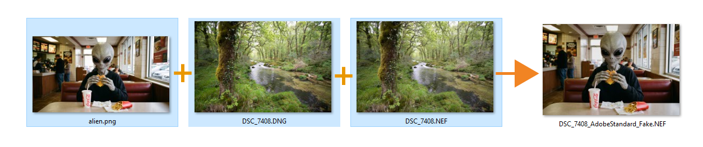
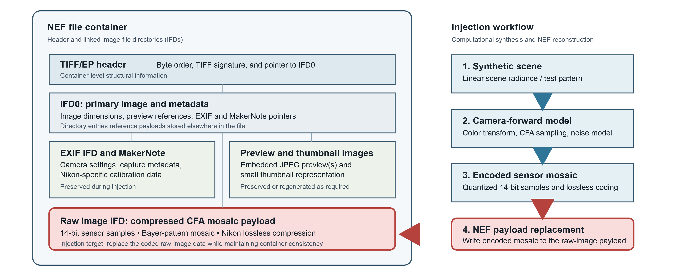
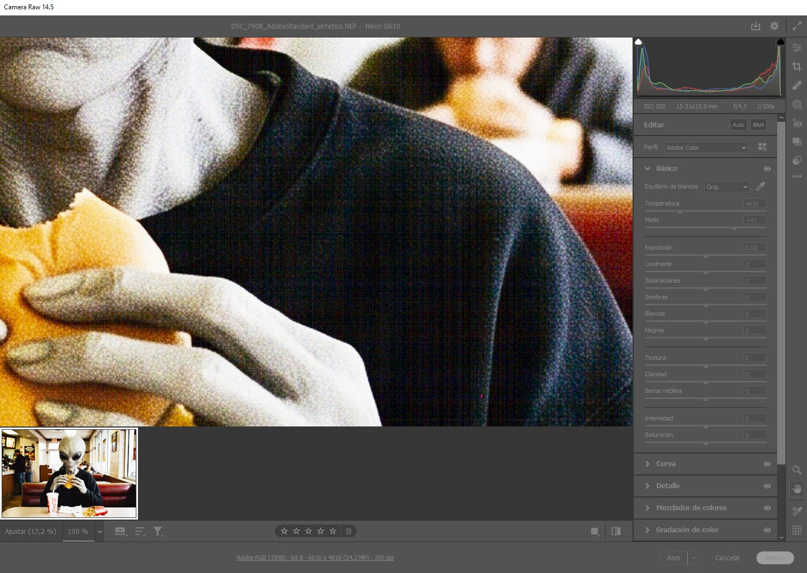
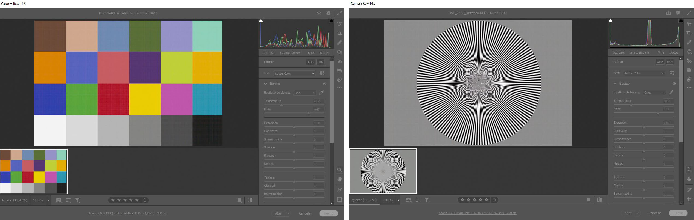

# `nefinject` — Scientific Library for Bayer Synthesis and Nikon NEF RAW Injection

[](https://doi.org/10.5281/zenodo.24322257)

*[Leer en español](README_ES.md)*

`nefinject` is a Python library designed to synthesize and inject Bayer mosaics into Nikon RAW files (`NIKON D610`, 14-bit Lossless `0x4630`), aimed at metrological evaluation and the analysis of **demosaicing**, **color management**, and **physical artifact response** algorithms in RAW converters (Adobe Camera Raw, Capture One, LibRaw, Darktable, RawTherapee).

All processing runs in memory, guaranteeing structural preservation of the original TIFF/MakerNote container and generating complete JSON traceability logs with SHA-256 checksums.



---

## Key Features

- **In-Memory Architecture:** Integrated execution from Python (`inject_synthetic_nef`, `NefSession`) or via the command-line interface (`nefinject`).
- **Optional Physical Simulation:**
  - **Pre-CFA Optics:** Modeling of point spread function (anisotropic Gaussian PSF), optical low-pass filter (4-tap sub-pixel OLPF), lateral chromatic aberration, polynomial radial distortion, and vignetting.
  - **Post-CFA Sensor:** Simulation of photon shot noise (Poisson), dark current, temporal read noise, photo-response / dark-signal non-uniformity (PRNU/DSNU), row/column banding, and defective pixels.
- **Dual Nikon 14-bit Lossless (`0x4630`) Encoding Engine:**
  - **Numba JIT Engine (`backend="numba"`):** High-performance optimized encoding and decoding.
  - **Vectorized NumPy Engine (`backend="numpy"`):** Pure-NumPy implementation with no external compiler dependencies.
- **DNG Profile Extraction:** Reading and interpolation of matrices (`ForwardMatrix`, `ColorMatrix`, `CameraCalibration`, `AnalogBalance`) and Adobe calibration lookup tables directly from DNG files.
- **Persistent Sessions (`NefSession`):** In-memory reuse of TIFF structures, metadata, and matrices for parameter sweeps (exposure, white balance, or image sequences).
- **Configurable Integrity Verification:** `fast`, `paranoid`, and `none` modes for structural container validation, internal codec round-trip verification, or sample-by-sample comparison against `rawpy`.



---

## Color Profile: Optional DNG

The DNG file is optional. When provided, `nefinject` extracts the Adobe profile and uses its matrices, calibration, and LUTs to build the `--kelvin`-dependent color transform.

Without `--dng`, the pipeline remains fully operational: it obtains a candidate **linear sRGB-to-camera** matrix and *as-shot* white balance from the NEF via LibRaw. If LibRaw is unavailable, it falls back to `rawpy`; as a last resort, it combines MakerNote data with the reference Nikon D610 matrix bundled in the library. The execution report identifies this mode as `LibRaw_Candidate`.

This mode is useful for generating synthetic NEFs and running tests, but it does not include `ForwardMatrix`, dual-illuminant matrices, `CameraCalibration`, `AnalogBalance`, LUT/DCP tables, or Adobe temperature interpolation. Therefore, for controlled colorimetric evaluations or comparisons against Adobe Camera Raw and Capture One, providing the corresponding DNG is recommended.

---

## Package Structure

```text
nefinject/
├── pyproject.toml
├── README.md
├── README_ES.md
├── src/
│   └── nefinject/
│       ├── __init__.py          # Public API
│       ├── models.py            # Dataclasses (InjectionConfig, PipelineResult) and SHA-256 utilities
│       ├── container.py         # TIFF/MakerNote parser, container patcher, and LibRaw probes
│       ├── color.py             # DNG profile and color matrix extractor
│       ├── synthesis.py         # Image-to-14-bit RGGB Bayer conversion and analytical patterns
│       ├── optics.py            # Pre-CFA optical modeling (PSF, OLPF, distortion, vignetting)
│       ├── sensor.py            # Post-CFA optoelectronic sensor modeling and PTC characterization
│       ├── profiles/            # Simulation presets and profiles
│       ├── codec.py             # Nikon 14-bit Lossless codec (Numba, NumPy, and Python reference engines)
│       ├── calibration.py       # CIEDE2000 (ΔE00) colorimetric measurement and mosaic comparison
│       ├── pipeline.py          # Injection workflow and session orchestrator
│       └── cli.py               # Command-line interface entry point
├── examples/
│   ├── ejemplo_inyeccion_simple.py
│   ├── ejemplo_barrido_demosaicing.py
│   └── ejemplo_simulacion_optica_y_sensor.py
└── figures/                     # Diagrams and sample captures for the README
```

---

## Installation

### Basic Installation (Minimal core: `numpy`, `Pillow`)
```bash
pip install -e .
```

### Full Installation (`numba` acceleration, `rawpy` verification, and optical support)
```bash
pip install -e ".[full,dev]"
```

---

## Python Usage

### 1. Direct Injection

```python
from nefinject import inject_synthetic_nef

result = inject_synthetic_nef(
    nef_path="test_images/DSC_7408.NEF",
    dng_path="test_images/DSC_7408.DNG",
    chart_path="test_images/alien.png",
    wb_gains=(1.0, 1.0, 1.0, 1.0),
    exposure_ev=-1.00,
    kelvin=6200.0,
    black_dn=0,
    white_dn=15000,
    verification_mode="fast",
)

print("Generated NEF:", result.output_nef_path)
print("SHA-256 NEF  :", result.output_nef_sha256)
print("SHA-256 Bayer:", result.bayer_sha256)
```

### 1.1 Siemens Star Pattern for Resolution and Moiré

To generate the pattern without providing an external image, omit `chart_path` and select `pattern="star"`. The pattern is a 144-cycle sinusoidal Siemens star; the generated input image (`siemens_star_srgb.png`) is saved inside the run directory.

```python
from nefinject import inject_synthetic_nef

result = inject_synthetic_nef(
    nef_path="test_images/DSC_7408.NEF",
    pattern="star",
)
```

`pattern="colorchecker"` is the default value. If `chart_path` is provided, that image is used and `pattern` is ignored.

### 2. Parameter Sweep with In-Memory Session

`NefSession` parses the NEF/DNG template once and keeps metadata in memory for subsequent runs:

```python
from nefinject import NefSession

session = NefSession(
    nef_path="test_images/DSC_7408.NEF",
    dng_path="test_images/DSC_7408.DNG",
)

for ev in (-2.0, -1.0, -0.5, 0.0):
    res = session.inject(
        chart_path="test_images/alien.png",
        exposure_ev=ev,
        kelvin=6200.0,
        black_dn=0,
        white_dn=15000,
        verification_mode="fast",
    )
    print(f"EV={ev:+.1f} -> {res.output_nef_path.name}")
```

### 3. Injection with Optical and Sensor Simulation

You can use built-in presets (`"example"`, `"noise_only"`, `"shading_only"`, `"identity"`), paths to JSON configuration files, or dataclass instances (`OpticsConfig`, `SensorConfig`):

```python
from nefinject import inject_synthetic_nef

result = inject_synthetic_nef(
    nef_path="test_images/DSC_7408.NEF",
    dng_path="test_images/DSC_7408.DNG",
    chart_path="test_images/alien.png",
    exposure_ev=-0.25,
    optics_profile="example",
    sensor_profile="noise_only",
    save_optics_tiff=False,
)

print("SHA-256 Ideal Bayer   :", result.bayer_sha256)
print("SHA-256 Degraded Bayer:", result.injected_bayer_sha256)
```



### 4. Colorimetric Evaluation of a Rendered TIFF

Computes color error metrics ($\Delta E_{00}$) over the regions of interest (ROIs) against the input chart:

```python
from nefinject import analyze_rendered_tiff

report_path, report = analyze_rendered_tiff(
    run_dir=result.run_dir,
    rendered_tiff="rendered_camera.tif",
)

print("Mean ΔE00:", report["summary"]["mean_delta_e00"])
```

---

## Command-Line Interface (CLI)

### 1. Standard Injection

```bash
nefinject run \
  --nef "test_images/DSC_7408.NEF" \
  --dng "test_images/DSC_7408.DNG" \
  --graft "test_images/alien.png" \
  --wb "1,1,1,1" \
  --ev -1.00 \
  --kelvin 6200 \
  --black-dn 0 \
  --white-dn 15000
```

### 2. Automatically Generated Patterns

`--graft` is optional. If omitted, `nefinject` generates a synthetic ColorChecker 24 chart in sRGB (`colorchecker24_srgb.png`) inside the run directory and uses it as input to synthesize and inject the NEF, removing the need to provide an external chart file:

```bash
nefinject run --nef template.NEF
```

To evaluate resolution and moiré, select a sinusoidal Siemens star. It is saved as `siemens_star_srgb.png` inside the run directory; `--pattern` is only used when `--graft` is not provided:

```bash
nefinject run --nef template.NEF --pattern star
```

It is also available in the public API as `generate_siemens_star_png(output_path, width=1800, height=1200, cycles=144, center_radius=24.0, outer_radius=None)` to generate only the pattern PNG.



### 3. Chart Orientation and Rotation

The chart is normalized according to its EXIF metadata and preserves its orientation by default:

```text
--orientation preserve          # default
--orientation match-sensor
--rotation cw | ccw
```

With `match-sensor`, if the chart and the physical sensor grid have different orientations, you must specify the rotation direction. Rotation is applied to the chart before resizing and Bayer sampling; the NEF container and its metadata are not rotated.

```bash
nefinject run \
  --nef "test_images/DSC_7408.NEF" \
  --graft "test_images/vertical_pattern.png" \
  --orientation match-sensor \
  --rotation cw
```

### 4. Injection with Artifact Simulation

```bash
nefinject run \
  --nef "test_images/DSC_7408.NEF" \
  --dng "test_images/DSC_7408.DNG" \
  --graft "test_images/alien.png" \
  --ev -0.25 \
  --optics-profile example \
  --sensor-profile noise_only \
  --render-png
```

### 5. Empirical Sensor Characterization (PTC / PRNU / DSNU)

Estimates conversion gain ($e^-/\text{DN}$), read noise, and calibration maps from sequences of dark frames (*darks*) and flat-field frames (*flats*):

```bash
nefinject characterize-sensor \
  --darks dark_01.npy dark_02.npy dark_03.npy \
  --flats flat_01.npy flat_02.npy flat_03.npy \
  --out-prefix "profiles/calibrated_sensor"
```

### 6. Rendered File Analysis

```bash
nefinject analyze-tiff \
  --run-dir "experimentos_dng/DSC_7408__AdobeDNG__..." \
  --tiff "rendered_evaluation.tif"
```

---

## Output Examples (NEF Files)

To avoid bloating the repository history with large RAW files, sample NEFs generated with `nefinject` are distributed as a compressed **Release** asset:

- [`NEF_results.zip`](https://github.com/jpereiranet/nefinject/releases/download/v1.0.0/NEF_results.zip) — Archive containing sample synthetic NEF outputs (external chart grafting, synthetic ColorChecker 24, sensor/optical noise simulation, and sinusoidal Siemens star) ready to open in RAW converters such as Adobe Camera Raw, Capture One, Darktable, or RawTherapee.

## Sample Input Files (`test_images`)

Likewise, the original input files used in the examples of this README (NEF template, DNG profile, and chart image) are available as a **Release** asset so you can reproduce the tests locally by extracting them into the `test_images/` folder:

- [`test_images.zip`](https://github.com/jpereiranet/nefinject/releases/download/v1.0.0/test_images.zip) — Archive containing the base Nikon D610 RAW container (`DSC_7408.NEF`), the optional Adobe color profile (`DSC_7408.DNG`), and sample graft images (`alien.png`).
