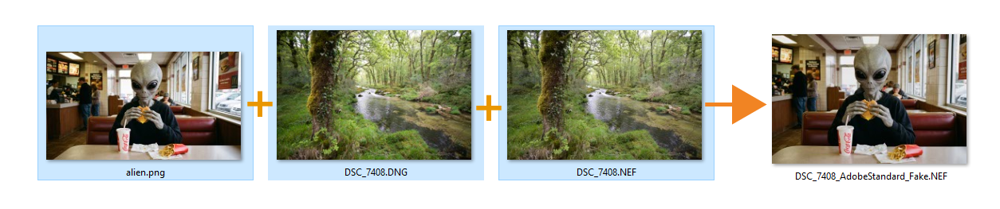
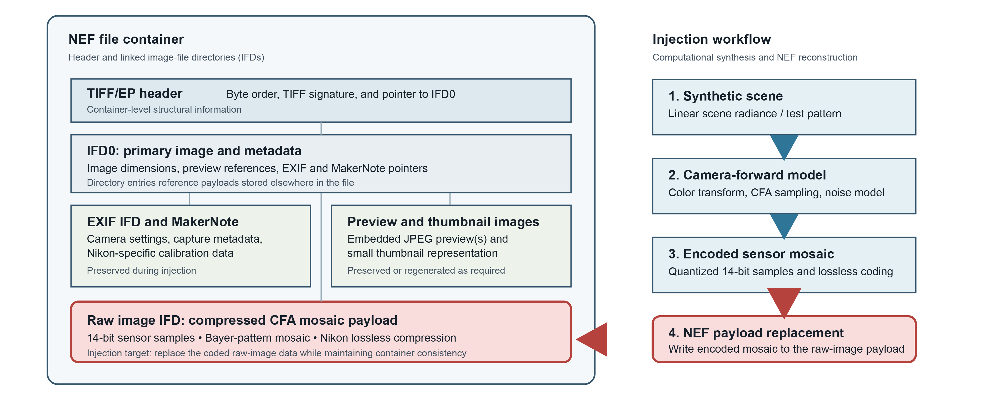
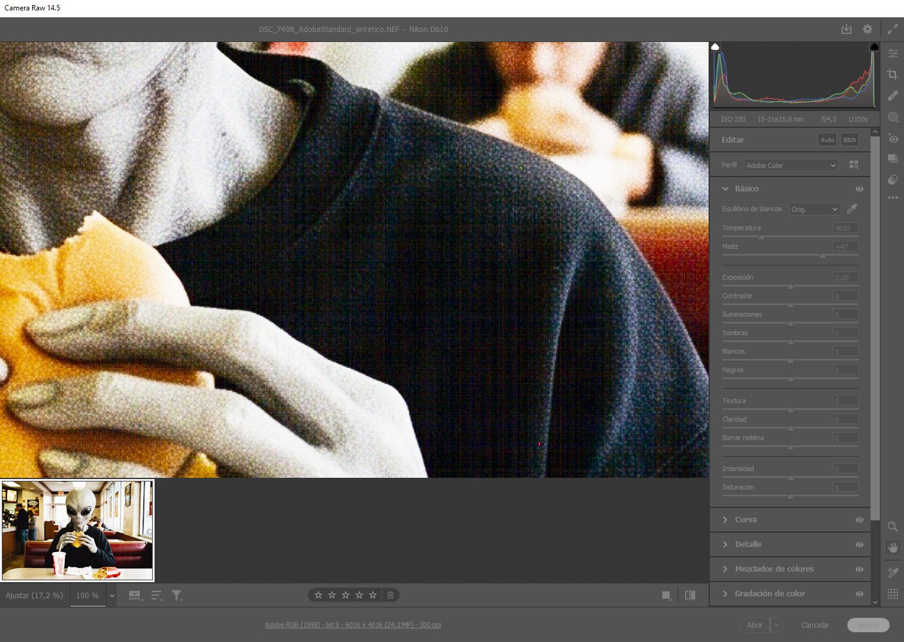
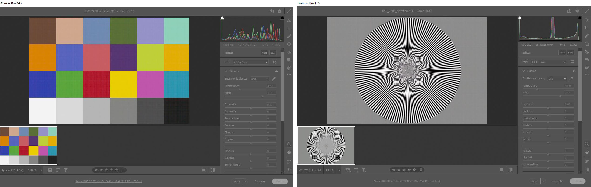

# `nefinject` — Librería Científica de Síntesis Bayer e Inyección RAW Nikon NEF

`nefinject` es una librería en Python diseñada para sintetizar e inyectar mosaicos Bayer en archivos RAW de Nikon (`NIKON D610`, 14-bit Lossless `0x4630`), orientada a la evaluación metrológica y el análisis de algoritmos de **demosaicing**, **gestión del color** y **respuesta a artefactos físicos** en reveladores RAW (Adobe Camera Raw, Capture One, LibRaw, Darktable, RawTherapee).

El procesamiento se ejecuta en memoria, garantizando la preservación estructural del contenedor TIFF/MakerNote original y generando registros completos de trazabilidad en formato JSON con cálculo de sumas de verificación SHA-256.



---

## Características Principales

- **Arquitectura en Memoria:** Ejecución integrada desde Python (`inject_synthetic_nef`, `NefSession`) o mediante interfaz de línea de comandos (`nefinject`).
- **Simulación Física Opcional:**
  - **Óptica pre-CFA:** Modelado de función de dispersión de punto (PSF gaussiana anisótropa), filtro óptico pasobajo (OLPF de 4 réplicas subpíxel), aberración cromática lateral, distorsión radial polinómica y viñeteado.
  - **Sensor post-CFA:** Simulación de ruido de disparo fotónico (Poisson), corriente oscura, ruido temporal de lectura, respuesta no uniforme (PRNU/DSNU), banding por filas/columnas y píxeles defectuosos.
- **Doble Motor de Codificación Nikon 14-bit Lossless (`0x4630`):**
  - **Motor JIT Numba (`backend="numba"`):** Codificación y decodificación optimizada para alto rendimiento.
  - **Motor Vectorizado NumPy (`backend="numpy"`):** Implementación sin dependencias de compiladores externos.
- **Extracción de Perfiles DNG:** Lectura e interpolación de matrices (`ForwardMatrix`, `ColorMatrix`, `CameraCalibration`, `AnalogBalance`) y tablas de calibración Adobe directamente desde archivos DNG.
- **Sesiones Persistentes (`NefSession`):** Reutilización en memoria de estructuras TIFF, metadatos y matrices para barridos de parámetros (exposición, balance de blancos o secuencias de imágenes).
- **Verificación de Integridad Configurable:** Modos `fast`, `paranoid` y `none` para validación estructural del contenedor, verificación interna del códec o comparación muestra a muestra con `rawpy`.



---

## Perfil de Color: DNG Opcional

El archivo DNG es opcional. Cuando se proporciona, `nefinject` extrae el perfil Adobe y usa sus matrices, calibración y LUTs para construir la transformación de color dependiente de `--kelvin`.

Sin `--dng`, el pipeline sigue siendo operativo: obtiene del NEF una matriz candidata de **sRGB lineal a cámara** y el balance de blancos *as shot* mediante LibRaw. Si LibRaw no está disponible, utiliza `rawpy`; como último recurso, combina los datos del MakerNote con la matriz de referencia de Nikon D610 incluida en la librería. El informe de ejecución identifica este modo como `LibRaw_Candidate`.

Este modo sirve para generar NEF sintéticos y realizar pruebas, pero no incorpora `ForwardMatrix`, matrices duales por iluminante, `CameraCalibration`, `AnalogBalance`, LUT/DCP ni la interpolación Adobe por temperatura. Por tanto, para evaluaciones colorimétricas controladas o comparaciones con Adobe Camera Raw y Capture One, se recomienda aportar el DNG correspondiente.

---

## Estructura del Paquete

```text
nefinject/
├── pyproject.toml
├── README.md
├── src/
│   └── nefinject/
│       ├── __init__.py          # API pública
│       ├── models.py            # Dataclasses (InjectionConfig, PipelineResult) y utilidades SHA-256
│       ├── container.py         # Analizador TIFF/MakerNote, parcheador de contenedor y sondas LibRaw
│       ├── color.py             # Extractor de perfiles DNG y matrices de color
│       ├── synthesis.py         # Conversión de imagen a mosaico Bayer RGGB de 14 bits y patrones analíticos
│       ├── optics.py            # Modelado óptico pre-CFA (PSF, OLPF, distorsión, viñeteado)
│       ├── sensor.py            # Modelado optoelectrónico de sensor post-CFA y caracterización PTC
│       ├── profiles/            # Presets y perfiles de simulación
│       ├── codec.py             # Códec Nikon 14-bit Lossless (motores Numba, NumPy y referencia Python)
│       ├── calibration.py       # Medición colorimétrica CIEDE2000 (ΔE00) y comparación de mosaicos
│       ├── pipeline.py          # Orquestador del flujo de inyección y sesiones
│       └── cli.py               # Punto de entrada de línea de comandos
├── examples/
│   ├── ejemplo_inyeccion_simple.py
│   ├── ejemplo_barrido_demosaicing.py
│   └── ejemplo_simulacion_optica_y_sensor.py
└── figures/                     # Diagramas y capturas de ejemplo para el README
```

---

## Instalación

### Instalación Básica (Núcleo mínimo: `numpy`, `Pillow`)
```bash
pip install -e .
```

### Instalación Completa (Aceleración `numba`, verificación `rawpy` y soporte óptico)
```bash
pip install -e ".[full,dev]"
```

---

## Uso desde Python

### 1. Inyección Directa

```python
from nefinject import inject_synthetic_nef

resultado = inject_synthetic_nef(
    nef_path="test_images/DSC_7408.NEF",
    dng_path="test_images/DSC_7408.DNG",
    chart_path="test_images/alien.png",
    wb_gains=(1.0, 1.0, 1.0, 1.0),
    exposure_ev=-1.00,
    kelvin=6200.0,
    black_dn=0,
    white_dn=15000,
    verification_mode="fast",
)

print("NEF generado :", resultado.output_nef_path)
print("SHA-256 NEF  :", resultado.output_nef_sha256)
print("SHA-256 Bayer:", resultado.bayer_sha256)
```

### 1.1 Patrón Siemens para resolución y muaré

Para generar el patrón sin aportar una imagen externa, omite `chart_path` y selecciona `pattern="star"`. El patrón es una estrella Siemens sinusoidal de 144 ciclos; la imagen de entrada generada (`siemens_star_srgb.png`) queda guardada en el directorio de la ejecución.

```python
from nefinject import inject_synthetic_nef

resultado = inject_synthetic_nef(
    nef_path="test_images/DSC_7408.NEF",
    pattern="star",
)
```

`pattern="colorchecker"` es el valor predeterminado. Si se proporciona `chart_path`, se utiliza esa imagen y `pattern` no interviene.

### 2. Barrido de Parámetros con Sesión en Memoria

`NefSession` analiza la plantilla NEF/DNG una única vez y mantiene los metadatos en memoria para ejecuciones sucesivas:

```python
from nefinject import NefSession

session = NefSession(
    nef_path="test_images/DSC_7408.NEF",
    dng_path="test_images/DSC_7408.DNG",
)

for ev in (-2.0, -1.0, -0.5, 0.0):
    res = session.inject(
        chart_path="test_images/alien.png",
        exposure_ev=ev,
        kelvin=6200.0,
        black_dn=0,
        white_dn=15000,
        verification_mode="fast",
    )
    print(f"EV={ev:+.1f} -> {res.output_nef_path.name}")
```

### 3. Inyección con Simulación Óptica y de Sensor

Se pueden utilizar presets incluidos (`"example"`, `"noise_only"`, `"shading_only"`, `"identity"`), rutas a archivos JSON de configuración o instancias de dataclasses (`OpticsConfig`, `SensorConfig`):

```python
from nefinject import inject_synthetic_nef

resultado = inject_synthetic_nef(
    nef_path="test_images/DSC_7408.NEF",
    dng_path="test_images/DSC_7408.DNG",
    chart_path="test_images/alien.png",
    exposure_ev=-0.25,
    optics_profile="example",
    sensor_profile="noise_only",
    save_optics_tiff=False,
)

print("SHA-256 Bayer Ideal    :", resultado.bayer_sha256)
print("SHA-256 Bayer Degradado:", resultado.injected_bayer_sha256)
```



### 4. Evaluación Colorimétrica de un TIFF Revelado

Calcula las métricas de error cromático ($\Delta E_{00}$) sobre las regiones de interés (ROIs) respecto a la carta de entrada:

```python
from nefinject import analyze_rendered_tiff

report_path, report = analyze_rendered_tiff(
    run_dir=resultado.run_dir,
    rendered_tiff="revelado_camara.tif",
)

print("ΔE00 medio:", report["summary"]["mean_delta_e00"])
```

---

## Interfaz de Línea de Comandos (CLI)

### 1. Inyección Estándar

```bash
nefinject run \
  --nef "test_images/DSC_7408.NEF" \
  --dng "test_images/DSC_7408.DNG" \
  --graft "test_images/alien.png" \
  --wb "1,1,1,1" \
  --ev -1.00 \
  --kelvin 6200 \
  --black-dn 0 \
  --white-dn 15000
```

### 2. Patrones Generados Automáticamente

`--graft` es opcional. Si se omite, `nefinject` genera una carta ColorChecker 24 sintética en sRGB (`colorchecker24_srgb.png`) dentro del directorio de la ejecución y la utiliza como entrada para sintetizar e inyectar el NEF. Así no es necesario aportar un archivo de carta externo:

```bash
nefinject run --nef plantilla.NEF
```

Para evaluar resolución y muaré, selecciona una estrella Siemens sinusoidal. Se guarda como `siemens_star_srgb.png` dentro del directorio de ejecución; `--pattern` solo se usa cuando no se proporciona `--graft`:

```bash
nefinject run --nef plantilla.NEF --pattern star
```

También está disponible en la API pública como `generate_siemens_star_png(output_path, width=1800, height=1200, cycles=144, center_radius=24.0, outer_radius=None)` para generar exclusivamente el PNG del patrón.



### 3. Orientación y Rotación de la Carta

La carta se normaliza según su EXIF y, por defecto, conserva su orientación:

```text
--orientation preserve          # valor predeterminado
--orientation match-sensor
--rotation cw | ccw
```

Con `match-sensor`, si la carta y la rejilla física del sensor tienen orientaciones distintas, se debe indicar el sentido de giro. La rotación se aplica a la carta antes del redimensionado y del muestreo Bayer; el contenedor NEF y sus metadatos no se rotan.

```bash
nefinject run \
  --nef "test_images/DSC_7408.NEF" \
  --graft "test_images/patron_vertical.png" \
  --orientation match-sensor \
  --rotation cw
```


### 4. Inyección con Simulación de Artefactos

```bash
nefinject run \
  --nef "test_images/DSC_7408.NEF" \
  --dng "test_images/DSC_7408.DNG" \
  --graft "test_images/alien.png" \
  --ev -0.25 \
  --optics-profile example \
  --sensor-profile noise_only \
  --render-png
```

### 5. Caracterización Empírica de Sensor (PTC / PRNU / DSNU)

Estima la ganancia ($e^-/\text{DN}$), desviación de lectura y mapas de calibración a partir de secuencias de capturas en oscuridad (*darks*) y campo plano (*flats*):

```bash
nefinject characterize-sensor \
  --darks dark_01.npy dark_02.npy dark_03.npy \
  --flats flat_01.npy flat_02.npy flat_03.npy \
  --out-prefix "perfiles/sensor_calibrado"
```

### 4. Análisis de Archivo Revelado

```bash
nefinject analyze-tiff \
  --run-dir "experimentos_dng/DSC_7408__AdobeDNG__..." \
  --tiff "revelado_evaluacion.tif"
```

---

## Ejemplos de Salida (Archivos NEF)

Para evitar que el historial del repositorio crezca innecesariamente con archivos RAW de gran tamaño, los NEF de ejemplo generados con `nefinject` se distribuyen comprimidos como adjunto (*Asset*) en la sección de **Releases** de GitHub:

- [`NEF_results.zip`](https://github.com/jpereiranet/nefinject/releases/download/v1.0.0/NEF_results.zip) — Archivo comprimido con ejemplos reales producidos por la librería (inyección de carta externa, ColorChecker 24 sintética, simulación de ruido/óptica y estrella Siemens sinusoidal) listos para abrir en reveladores RAW como Adobe Camera Raw, Capture One, Darktable o RawTherapee.

## Archivos de Entrada de Ejemplo (`test_images`)

Del mismo modo, los archivos originales de entrada utilizados en los ejemplos de este README (plantilla NEF, perfil DNG e imagen de carta) están disponibles como adjunto en el **Release** para que puedas reproducir las pruebas localmente extrayéndolos en la carpeta `test_images/`:

- [`test_images.zip`](https://github.com/jpereiranet/nefinject/releases/download/v1.0.0/test_images.zip) — Archivo comprimido con el RAW original de Nikon D610 usado como contenedor/plantilla base (`DSC_7408.NEF`), el perfil colorimétrico Adobe opcional (`DSC_7408.DNG`) e imágenes externas de ejemplo (`alien.png`).

