# Guía Completa de Modelado, Parametrización y Uso de Simuladores (Óptica y Sensor)

Este documento detalla la fundamentación física, la parametrización matemática exacta, el comportamiento de los presets empaquetados y ejemplos de uso tanto por **CLI** como por **API de Python** para los dos simuladores integrados en `nefinject`:

1. **Simulador Óptico Pre-CFA** (`nefinject.optics`): degradaciones espaciales y cromáticas en el dominio continuo RGB lineal antes del muestreo del sensor.
2. **Simulador Optoelectrónico de Sensor Post-CFA** (`nefinject.sensor`): fenómenos de ruido temporal, patrón espacial fijo (FPN), píxeles defectuosos y cuantificación sobre el mosaico Bayer RGGB.

---

## 1. Cadena de Procesamiento Físico y Separación de Dominios

```mermaid
flowchart TD
    A["Carta RGB Digital (sRGB / Lineal)"] --> B["Linealización EOTF IEC 61966-2-1"]
    subgraph ETAPA_OPTICA["1. Simulador Óptico (Dominio RGB Lineal Float32)"]
        B --> C["Reescalado a Malla del Sensor (4028 × 6080)"]
        C --> D["Distorsión Geométrica Radial (k1, k2)"]
        D --> E["Aberración Cromática Lateral (Escalado R/B vs G)"]
        E --> F["PSF Gaussiana Anisótropa (Convolución σx, σy)"]
        F --> G["Filtro OLPF (4 Réplicas Subpíxel ±dx/2, ±dy/2)"]
        G --> H["Viñeteado Óptico Radial V(r)"]
    end
    H --> I["Matriz 3×3 Inversa Adobe DNG + WB + EV"]
    I --> J["Muestreo al Mosaico CFA Bayer RGGB"]
    J --> K["BAYER IDEAL (uint16)\nbayer_final.npy (Referencia Ground-Truth)"]
    subgraph ETAPA_SENSOR["2. Simulador de Sensor (Dominio Fotositos Bayer uint16)"]
        K --> L["Conversión Cuentas DN -> Fotoelectrones Esperados e⁻"]
        L --> M["Sombreado de Lente / Color Shading por Canal CFA"]
        M --> N["Respuesta No Uniforme (PRNU Fijo y/o Mapa .npy)"]
        N --> O["Ruido de Disparo Fotónico Poisson (Shot Noise)"]
        O --> P["Corriente Oscura Térmica Poisson (Dark Current)"]
        P --> Q["Patrón Fijo de Oscuridad (DSNU Gaussiano y/o Mapa .npy)"]
        Q --> R["Banding Fijo y Temporal por Fila / Columna"]
        R --> S["Ruido Temporal de Lectura Gaussiano (Read Noise)"]
        S --> T["Píxeles Defectuosos (Muertos y Calientes ppm o Mapa .npy)"]
        T --> U["Recuantificación ADC [BlackDN, WhiteDN]"]
    end
    U --> V["BAYER DEGRADADO (uint16)\nbayer_sensor.npy (Inyectado en NEF)"]
    V --> W["Codificador Nikon 14-bit Lossless (0x4630)"]
    W --> X["Archivo RAW NEF Sintético"]
```



---

## 2. Simulador Óptico Pre-CFA (`OpticsConfig`)

La degradación óptica opera sobre una matriz $H \times W \times 3$ en coma flotante normalizada $[0, 1]$, antes de separar los canales en el mosaico Bayer.

### 2.1. Parámetros del Perfil JSON / Dataclass

| Clave JSON | Tipo / Rango | Unidad | Parámetro Dataclass | Descripción Física |
| :--- | :---: | :---: | :--- | :--- |
| `psf.sigma_x_px` | Float $[0, 30]$ | Píxeles | `PSF.sigma_x_px` | Desviación típica del desenfoque gaussiano horizontal en la malla del sensor. |
| `psf.sigma_y_px` | Float $[0, 30]$ | Píxeles | `PSF.sigma_y_px` | Desviación típica del desenfoque gaussiano vertical. Si $\sigma_x \ne \sigma_y$, modela astigmatismo/anisotropía. |
| `olpf.separation_x_px` | Float $[0, 12]$ | Píxeles | `OLPF.separation_x_px` | Distancia total entre réplicas generadas por el filtro birrefringente pasobajo en X. |
| `olpf.separation_y_px` | Float $[0, 12]$ | Píxeles | `OLPF.separation_y_px` | Distancia total entre réplicas en Y. Para Nikon D610, valores típicos rondan $0.5$–$0.7$ px. |
| `vignetting.edge_factor`| Float $(0, 1]$ | Factor $[0, 1]$ | `Vignetting.edge_factor` | Transmisión lumínica relativa en las esquinas más alejadas ($r=1.0$). $1.0$ = sin viñeteado. |
| `vignetting.power` | Float $[0.1, 12]$ | Exponente | `Vignetting.power` | Exponente de la caída radial. $2.0$ corresponde a una ley aproximadamente parabólica / $\cos^4$. |
| `vignetting.center_x` | Float $[0, 1]$ | Fracción | `Vignetting.center_x` | Coordenada horizontal del eje óptico ($0.5$ = centro geométrico exacto). |
| `vignetting.center_y` | Float $[0, 1]$ | Fracción | `Vignetting.center_y` | Coordenada vertical del eje óptico ($0.5$ = centro geométrico exacto). |
| `lateral_ca.red_scale_delta` | Float $[-0.1, 0.1]$ | Fracción | `LateralCA.red_scale_delta` | Factor de escala radial diferencial del canal Rojo respecto al Verde ($+0.0003$ agranda R hacia los bordes). |
| `lateral_ca.blue_scale_delta`| Float $[-0.1, 0.1]$ | Fracción | `LateralCA.blue_scale_delta` | Factor de escala radial diferencial del canal Azul respecto al Verde ($-0.0003$ encoge B). |
| `distortion.k1` | Float $[-0.7, 0.7]$ | Adimensional | `Distortion.k1` | Coeficiente radial de segundo orden ($k_1 < 0$ produce distorsión en barril; $k_1 > 0$ en cojín). |
| `distortion.k2` | Float $[-0.7, 0.7]$ | Adimensional | `Distortion.k2` | Coeficiente radial de cuarto orden para corrección o distorsión compleja tipo bigote. |
| `background_linear` | Float $[0, 1]$ | Reflectancia | `background_linear` | Valor de reflectancia neutra ($0.18 = 18\%$ gris medio) para rellenar márgenes en modo `contain`. |

### 2.2. Ecuaciones Matemáticas Aplicadas

1. **Radio normalizado al semidiagonal:**
   $$\Delta x = x - x_c, \quad \Delta y = y - y_c, \quad r^2 = \frac{\Delta x^2 + \Delta y^2}{\left(\frac{W-1}{2}\right)^2 + \left(\frac{H-1}{2}\right)^2}$$
2. **Distorsión y Aberración Cromática Lateral:**
   $$s_c(r) = \left(1 + k_1 r^2 + k_2 r^4\right) \cdot (1 + \delta_c), \quad \delta_c \in \{\delta_{\text{red}}, 0, \delta_{\text{blue}}\}$$
   $$(x', y') = (x_c + \Delta x \cdot s_c(r), \; y_c + \Delta y \cdot s_c(r))$$
3. **Filtro Birrefringente OLPF (4 réplicas discretas subpíxel):**
   $$I_{\text{OLPF}}(x, y) = \frac{1}{4} \sum_{s_x \in \{-0.5, 0.5\}} \sum_{s_y \in \{-0.5, 0.5\}} I\left(x + s_x \cdot d_x, \; y + s_y \cdot d_y\right)$$
4. **Viñeteado Óptico:**
   $$V(r) = 1 - (1 - V_{\text{edge}}) \cdot r^p, \quad I_{\text{final}}(x, y) = I_{\text{OLPF}}(x, y) \cdot V(r)$$

---

## 3. Simulador Optoelectrónico de Sensor Post-CFA (`SensorConfig`)

Opera sobre el mosaico Bayer entero (`uint16`) $4028 \times 6080$ con un único fotosito por posición espacial.

### 3.1. Parámetros del Perfil JSON / Dataclass

| Clave JSON | Tipo | Unidad | Parámetro Dataclass | Descripción Física y Metrología |
| :--- | :---: | :---: | :--- | :--- |
| `cfa` | String | Enum | `cfa` | Disposición de la retícula Bayer (`"RGGB"`, `"BGGR"`, `"GRBG"`, `"GBRG"`). |
| `black_dn` | Int $[0, 65534]$ | DN | `black_dn` | Nivel digital de negro ($0$ para Nikon D610 con matriz DNG sin sesgo). |
| `white_dn` | Int $[1, 65535]$ | DN | `white_dn` | Nivel digital de saturación máxima de 14 bits ($15000$ o $16383$). |
| `electrons_per_dn` | Float $>0$ | $e^-/\text{DN}$ | `electrons_per_dn` | Ganancia inversa del sistema $k$. A ISO 100 en D610 ronda aproximadamente $3.8$–$4.2 \; e^-/\text{DN}$. |
| `shot_noise_enabled` | Bool | Flag | `shot_noise_enabled` | Si es `true`, aplica ruido de Poisson sobre los fotoelectrones ($\sigma = \sqrt{N_{e^-}}$). |
| `read_noise_e` | Float $\ge 0$ | $e^-\text{ RMS}$ | `read_noise_e` | Ruido temporal gaussiano de lectura del amplificador y conversor ADC ($\sim 1.5$–$2.5 \; e^-$ en ISO 100). |
| `prnu_fraction` | Float $[0, 0.5]$ | Fracción RMS | `prnu_fraction` | Desviación relativa de la sensibilidad espacial de cada fotosito ($0.004 = 0.4\%$ FPN multiplicativo). |
| `dsnu_e` | Float $\ge 0$ | $e^-\text{ RMS}$ | `dsnu_e` | Desviación estándar del offset aditivo de corriente oscura no uniforme píxel a píxel. |
| `row_fpn_e` / `col_fpn_e` | Float $\ge 0$ | $e^-\text{ RMS}$ | `row_fpn_e` / `col_fpn_e` | Ruido de patrón fijo de filas / columnas (banding espacial estático). |
| `row_temporal_e` / `col_temporal_e` | Float $\ge 0$ | $e^-\text{ RMS}$ | `row_temporal_e` / `col_temporal_e` | Banding temporal aleatorio cuadro a cuadro por lectura de línea en el sensor. |
| `dark_current_e_per_s` | Float $\ge 0$ | $e^-/\text{s}$ | `dark_current_e_per_s` | Tasa media de acumulación de electrones térmicos por fotosito a la temperatura dada. |
| `exposure_s` | Float $\ge 0$ | Segundos | `exposure_s` | Tiempo de integración/obturación para el cálculo de corriente oscura ($t_{\text{int}}$). |
| `vignette.edge_factor` | Float $(0, 1]$ | Factor | `Vignette.edge_factor` | Caída de sensibilidad en esquinas debida al ángulo de incidencia en los micro-lentes del sensor. |
| `vignette.power` | Float $>0$ | Exponente | `Vignette.power` | Exponente de caída radial del sensor. |
| `color_shading_edge_factors` | Lista de 4 floats | Factores | `color_shading_edge_factors` | Factores cromáticos en las esquinas para $[R, G_1, G_2, B]$ (ej. $[0.99, 1.0, 1.0, 1.02]$). |
| `defects.dead_ppm` | Float $\ge 0$ | ppm | `Defects.dead_ppm` | Partes por millón de píxeles ciegos / muertos (fuerzan la señal a $0$ DN). |
| `defects.hot_ppm` | Float $\ge 0$ | ppm | `Defects.hot_ppm` | Partes por millón de píxeles calientes (*hot pixels* con fuga de corriente elevada). |
| `defects.hot_e` | Float $\ge 0$ | $e^-$ | `Defects.hot_e` | Carga espuria en electrones inyectada a los píxeles calientes (ej. $5000 \; e^-$). |
| `fixed_seed` | Entero $\ge 0$ | Semilla | `fixed_seed` | Semilla determinista del patrón espacial fijo (PRNU, DSNU, defectos, banding estático). |
| `temporal_seed` | Entero $\ge 0$ | Semilla | `temporal_seed` | Semilla del ruido temporal de captura (Poisson, lectura gaussiana, banding dinámico). |
| `tile_rows` | Int $[2, 8192]$ | Filas | `tile_rows` | Tamaño de bloque de procesamiento en memoria ($128$ filas por defecto para bajo consumo de RAM). |
| `fixed_maps` | Objeto | Rutas | `FixedMaps` | Rutas a matrices `.npy` calibradas empíricamente (`prnu_npy`, `dsnu_e_npy`, `defects_npy`). |

### 3.2. Ecuaciones del Modelo Optoelectrónico

1. **Fotoelectrones esperados con viñeteado y sombreado:**
   $$\mu_{e^-}(x, y) = \max\left(\text{DN}_{\text{ideal}}(x, y) - \text{BlackDN}, \; 0\right) \cdot k \cdot V_{\text{sensor}}(r) \cdot S_{\text{color}}(c, r)$$
2. **Modulación de sensibilidad por fotosito (PRNU):**
   $$\lambda_{e^-}(x, y) = \mu_{e^-}(x, y) \cdot \left(1 + \delta_{\text{PRNU}}(x, y)\right)$$
3. **Fluctuaciones temporales y aditivas:**
   $$N_{\text{foto}} \sim \operatorname{Poisson}\left(\lambda_{e^-}\right), \quad N_{\text{dark}} \sim \operatorname{Poisson}\left(i_d \cdot t_{\text{exp}}\right)$$
   $$Q_{e^-} = N_{\text{foto}} + N_{\text{dark}} + \text{DSNU}(x, y) + \text{FPN}_{\text{fila}}(y) + \text{FPN}_{\text{col}}(x) + \mathcal{N}\left(0, \sigma_{\text{read}}^2\right) + \eta_{\text{fila}}(y) + \eta_{\text{col}}(x) + \Delta_{\text{defecto}}(x, y)$$
4. **Conversión analógico-digital y cuantificación entera:**
   $$\text{DN}'(x, y) = \operatorname{clip}\left(\operatorname{round}\left(\text{BlackDN} + \frac{Q_{e^-}}{k}\right), \; \text{BlackDN}, \; \text{WhiteDN}\right)$$

---

## 4. Catálogo de Presets Empaquetados

La librería incluye 6 presets listos para usar en el submódulo `nefinject.profiles`:

| Tipo | Nombre de Preset | Archivo JSON | Propósito Experimental |
| :--- | :--- | :--- | :--- |
| **Óptica** | `'example'` | `optics_profile_example.json` | Modela un objetivo realista: $\sigma = 0.65$ px, OLPF $= 0.6$ px, viñeteado $82\%$, aberración cromática $+0.03\%$ R / $-0.03\%$ B. |
| **Óptica** | `'identity'` | `optics_profile_identity.json` | **Control de identidad:** no introduce ningún desenfoque, ni OLPF, ni aberración ni caída de luz ($\Delta = 0$). |
| **Sensor** | `'example'` | `sensor_profile_example.json` | Modelo completo con ruido fotónico Poisson, ruido de lectura $2.0 \; e^-$, PRNU $0.4\%$, DSNU $0.5 \; e^-$, viñeteado $78\%$, color shading y defectos. |
| **Sensor** | `'noise_only'` | `sensor_profile_noise_only.json` | **Solo ruido electrónico y fotónico:** mantiene viñeteado $= 1.0$ y color shading $= 1.0$. Ideal para usar junto con `optics_profile_example` y evitar duplicar el viñeteado. |
| **Sensor** | `'shading_only'`| `sensor_profile_shading_only.json` | **Control de ablación:** aplica caída de luz y respuesta por canal CFA sin ruido estocástico (ruido Poisson, lectura y defectos desactivados). |
| **Sensor** | `'identity'` | `sensor_profile_identity.json` | **Control de identidad:** preserva exactamente el array de entrada sin modificar ningún fotosito ($\text{DN}' = \text{DN}$). |

---

## 5. Ejemplos de Uso Práctico

### 5.1. Desde la Línea de Comandos (CLI `nefinject`)

```powershell
# Caso 1: Óptica completa + Solo ruido de sensor (evita duplicar viñeteado)
nefinject run `
  --nef ".\datos\DSC_4415.NEF" `
  --dng ".\datos\DSC_4415.DNG" `
  --graft ".\datos\carta_color_demo.png" `
  --wb "1,1,1,1" `
  --ev -0.25 `
  --kelvin 6200 `
  --optics-profile example `
  --sensor-profile noise_only `
  --render-png

# Caso 2: Usar archivos JSON personalizados fuera del paquete
nefinject run `
  --nef ".\datos\DSC_4415.NEF" `
  --dng ".\datos\DSC_4415.DNG" `
  --graft ".\datos\carta_color_demo.png" `
  --optics-profile ".\mis_perfiles\mi_objetivo_50mm.json" `
  --sensor-profile ".\mis_perfiles\mi_sensor_iso400.json"

# Caso 3: Exportar el TIFF RGB lineal intermedio de 294 MB (por defecto se procesa en RAM)
nefinject run `
  --nef ".\datos\DSC_4415.NEF" `
  --dng ".\datos\DSC_4415.DNG" `
  --graft ".\datos\carta_color_demo.png" `
  --optics-profile example `
  --save-optics-tiff
```

### 5.2. Desde Scripts en Python

```python
from pathlib import Path
from nefinject import (
    inject_synthetic_nef,
    OpticsConfig,
    PSF,
    OLPF,
    Vignetting,
    SensorConfig,
    Vignette,
    Defects,
)

# 1. Definición programática con objetos tipados
optica_personalizada = OpticsConfig(
    psf=PSF(sigma_x_px=0.8, sigma_y_px=0.8),
    olpf=OLPF(separation_x_px=0.6, separation_y_px=0.6),
    vignetting=Vignetting(edge_factor=0.85, power=2.0),
)

sensor_personalizado = SensorConfig(
    electrons_per_dn=3.9,
    read_noise_e=2.2,
    prnu_fraction=0.005,
    shot_noise_enabled=True,
    defects=Defects(hot_ppm=1.5, hot_e=7000.0),
)

# 2. Inyección con conservación de ground-truth en RAM
resultado = inject_synthetic_nef(
    nef_path=r".\datos\DSC_4415.NEF",
    dng_path=r".\datos\DSC_4415.DNG",
    chart_path=r".\datos\carta_color_demo.png",
    wb_gains=(1.0, 1.0, 1.0, 1.0),
    exposure_ev=-0.25,
    kelvin=6200.0,
    black_dn=0,
    white_dn=15000,
    optics_profile=optica_personalizada,   # O simplemente "example"
    sensor_profile=sensor_personalizado,   # O simplemente "noise_only"
    save_optics_tiff=False,                # 100% en RAM, no escribe los 294 MB del TIFF
)

print(f"Carpeta del experimento : {resultado.run_dir}")
print(f"NEF Sintético generado  : {resultado.output_nef_path}")
print(f"SHA-256 Bayer Ideal     : {resultado.bayer_sha256} (bayer_final.npy)")
print(f"SHA-256 Bayer Degradado : {resultado.injected_bayer_sha256} (bayer_sensor.npy)")
```

---

## 6. Buenas Prácticas y Metrología Experimental

1. **Separación de variables (Estudios de ablación):**
   * Para medir exclusivamente el **muaré y aliasing de demosaicing**: usar `optics_profile="example"` y `sensor_profile="identity"`.
   * Para medir el **impacto del ruido en la estimación de color ($\Delta E_{00}$)**: fijar la óptica en `identity` y variar el ruido con `sensor_profile`.
2. **Evitar doble caída de luz periférica:**
   * Si activas el viñeteado en la etapa óptica (`vignetting.edge_factor < 1.0`), utiliza en el sensor el preset `noise_only` (que tiene `vignette.edge_factor = 1.0`). Si activas ambos simultáneamente, el borde recibirá una atenuación multiplicativa doble ($V_{\text{total}} = V_{\text{óptica}} \cdot V_{\text{sensor}}$).
3. **Reproducibilidad estricta:**
   * Para comparar algoritmos sobre exactamente la misma distribución de ruido, mantén fijas `fixed_seed` y `temporal_seed`.
   * Para realizar estudios de Monte Carlo con $N \ge 10$ capturas del mismo sensor, mantén fijo `fixed_seed` (el sensor no cambia físicamente) e incrementa `temporal_seed` en cada corrida.

